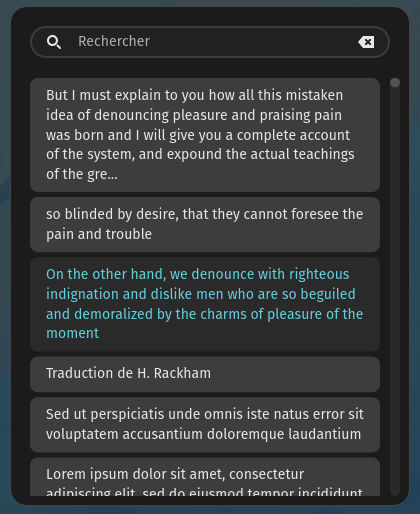

# Área de transferência (Clipboard Manager)

O histórico da área de transferência para o [COSMIC](https://system76.com/cosmic), com as cores do theme pack do [MeowSystem](https://github.com/vitoriamariadb/MeowSystem).

## De onde vem

A Área de transferência é um fork do **[clipboard-manager](https://github.com/cosmic-utils/clipboard-manager)**, de **wiiznokes** e da comunidade cosmic-utils. O histórico, a busca, os favoritos e o popup são trabalho deles. Este fork muda o nome (`meowsystem-clipboard`, app id `io.github.meowsystem.Clipboard`), acrescenta a extensão de tema do MeowSystem, a poda do histórico (1000 entradas, 1 GB de imagem, favoritos intocados) e a cópia do histórico do applet antigo, tudo descrito em [INTEGRACAO.md](INTEGRACAO.md). A licença continua a do original, GPL-3.0 ([LICENSE](LICENSE)). Autoria do fork: Vitória Maria e André Farias.

---

# Clipboard manager for COSMIC™



The goal is to make a simple yet fast clipboard history, with a focus on UX, rapidity and security.

There is a quick settings popup when you right click the icon.

## Install

The MeowSystem builds and installs it from the commit pinned in `assets/extensoes/clipboard.pino`. By hand, `just install-user` puts it in `~/.local`.

You can also build from source. For this you need to install [rust](https://rust-lang.org/tools/install/), [just](https://github.com/casey/just), and follow the the [build instruction](./BUILD.md).

## Logs

```sh
journalctl -p 3 -xb --user _EXE=/usr/bin/meowsystem-clipboard | less
```

- `-p` 3 means priority error
- `-x` add information
- `b` means since last boot

## Testing bundle

```sh
# install
flatpak install --user clipboard-manager.flatpak
# run specific branch
flatpak run --branch=testing io.github.meowsystem.Clipboard
# to be sure cosmic-panel will launch the wanted version
flatpak uninstall --user io.github.meowsystem.Clipboard//master
# or verify the commit with
flatpak run io.github.meowsystem.Clipboard -V
# uninstall testing repo and app
flatpak remote-delete --user meowsystem-clipboard-origin
```

## Build from source

Instructions are in [this file](./BUILD.md).

## Contributing

See [this file](./CONTRIBUTING.md).
